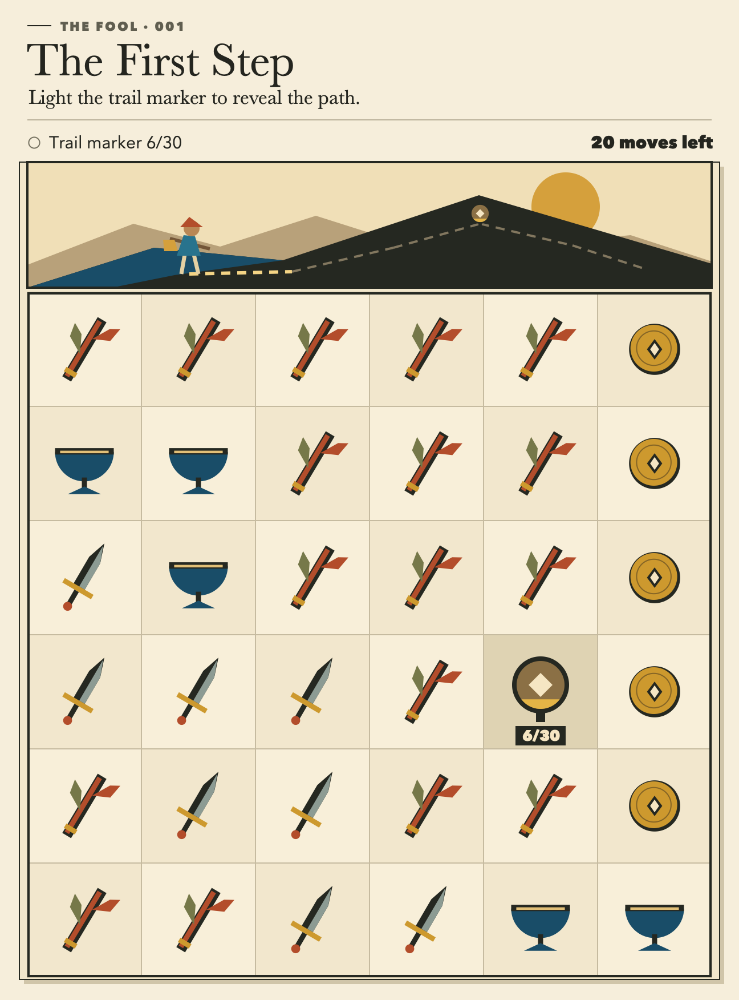

# The Fool · opening deals

## Level 001 · The Fool’s Step

The mobile tutorial uses the six guided strokes below. It teaches play using paths, a pointer, suit marks and aim arrows printed over the board. Each guided move opens a paper hint bubble on the board with one short explanation of the stroke’s effect. The subtitle states the objective. The Wand symbol, scoring suit and fixed trail marker with its light counter appear from the start. The guidance ends after the sixth stroke. The retry control appears only after a failure. The archived web study used the title **The First Step** and revealed the marker after move three.

The Fool's first puzzle teaches single-suit shapes and how to light one objective. The animated pointer hand draws each gesture on the live 6 × 6 board. The player repeats it and watches the pieces settle. The [campaign atlas](campaign-001-220.md#0--the-fool--prologue-001019) describes the rest of the Fool's prologue.

The Fool waits below a ridge with a staff and a bundle. The dark slope, gold circle and broken diagonal take their shapes from the card. As the trail marker gains light, the same progress reveals the path in the illustration. When it reaches 30 light, the trail becomes continuous and the Fool takes the first step. [The Fool card artwork](../deck/rider-waite-smith/svg/majors/00-the-fool.svg)

### Rules in play

The mobile opening teaches horizontal and vertical traces, squares and rectangles. Lozenges are reserved for a later puzzle group with its own combos. The archived web playtest examples below record the earlier lozenge rules.

**Objective.** Collect 30 light at E4. The 6 × 6 grid begins with the unlit marker at E4 and one suit piece in each other cell. The marker stays fixed and retains all light between moves.

**Scoring suit.** Show the Wand symbol to the right of the ridge scene from the start. Give it the accessible label **Wands**. The symbol identifies the suit that earns light even when the marker matches another suit as a wildcard corner. Print the light total and target on the marker’s plaque.

**Ordinary traces.** Connect two or more pieces of one suit through horizontal or vertical neighbours. The trace can turn and visit each cell once. Drag back over the previous piece to shorten the trace. Returning to the origin of an unfinished gesture should let the player choose another direction within the same drag. Release commits a valid stroke. An incomplete or cancelled gesture spends zero moves.

**Squares and rectangles.** Draw four straight sides along the rows and columns and close the outline. A square is a rectangle with equal sides. Start at a corner or along a side and draw in either direction. The ordinary corner pieces must share a suit. The trail marker can stand in for any suit at a corner and stays on the board. The sides can pass over other pieces and the marker. The outline must stay clear of blocked cells and can enclose them. On release, pieces of every suit clear inside and along the outline, and any light earned from the rectangle goes to the marker. See the [shared gesture rules](product-requirements.md#what-happens-under-the-finger).

| Stroke | Light gained |
|---|---|
| A Wand trace ends immediately next to E4, with its final step pointing into the marker. | 1 per Wand in the whole trace. The last segment sets the aim even if the trace turns. |
| A rectangle whose ordinary corners are all Wands encloses E4 or passes over it along a side. | 4, regardless of its size. |
| E4 is a corner of a rectangle whose other corners are all Wands. | 1 per Wand cleared inside or along the sides, with a minimum of 1. |
| Any other legal trace or rectangle, including a rectangle of Cups, Swords or Coins that uses E4 as a corner. | 0. The clear can bring pieces into position for a later hit or rectangle. |

**Settle and refill.** A committed stroke costs one move. Surviving pieces fall within their columns, past the fixed marker where applicable, and new pieces enter at the top. The six guided moves use fixed arrivals. In free play, each column cycles through its own four-arrival sequence containing one of each suit. Restart restores the starting board, the guide and the refill sequence. There is no timer or Undo.

**Win and lose.** Reach 30 light by the end of move 25. The six guided moves count toward the limit, leaving 19 moves at handoff. Running out of moves with the marker incomplete costs one life. When leaving an unfinished deal, choose Keep Playing to resume or Return to Path to spend one life and exit. Try Again restores the guide and opening board while a life remains. When the last life is spent, the result explains when retry becomes available. Check the campaign path or phase preview for the hearts and refill time.

| Moves used in a clear | Result |
|---|---|
| 13 or fewer | Three stars and the under-par mark |
| 14 | Three stars |
| 15–20 | Two stars |
| 21–25 | One star |

### Guided opening

| Move | What the hand draws | What the player sees |
|---|---|---|
| 1 | C1 → C2 | Two matching Wands clear. |
| 2 | D1 → F1 → F3 → D3 → D1 | The matching Wand corners close a 3 × 3 square and clear all nine pieces along and inside it. |
| 3 | A2 → D2 → D4 → A4 → A2 | The wider Cup rectangle clears twelve pieces across all four suits, including the Coin at B3 and the Cup at C3. The marker stays outside the outline at 0/30. |
| 4 | D2 → F2 → F5 → D5 → D2 | The taller Wand rectangle clears eleven pieces, including Coins and Swords, and adds 4 light to the enclosed marker. |
| 5 | E2 → E3 | The Wand trace ends beside the marker and points south into E4 for 2 more light. |
| 6 | E3 → F3 → F4 → E4 → E3 | The marker matches the three Coin corners as a wildcard. All three Coins clear and the marker stays at 6/30. The hand disappears with 19 moves left. |

### Replicate the deal

Use board `001`, titled **The Fool’s Step**, with the `ridge` scene, an empty hand, 30 light required, par 14 and a 25-move limit. Columns run A–F from left to right and rows run 1–6 from top to bottom. `W` is Wand, `C` Cup, `S` Sword, `O` Coin and `L` the fixed trail marker. The playtest stores the marker as a lamp receiver at zero-based index 22, caps Wand reach at one, and gives it no fading or blessing. The mobile opening uses the authored starting board and arrivals below. The archived web implementation used seed `18` and is in `playtest/boards.js` and `playtest/engine.js`.

```text
    A B C D E F
1   S S W W O W
2   C S W W C O
3   S O C W W W
4   C S S C L O
5   W S S W W W
6   W W S S C C
```

The hand marks one gesture at a time. The playtest waits for that gesture and spends a move only when it is released successfully. The first pair can be drawn in either direction. Squares and rectangles can start at a corner or along a side and run either way. The scoring trace in move 5 must point toward E4. A valid stroke away from the marked gesture during the guide leaves the board in place and repeats the instruction.

Use these arrivals with the six routes above. In each column, the first letter takes the lowest vacancy after the surviving pieces fall. An empty entry means that column receives no pieces on that move.

| Guided move | A | B | C | D | E | F | Pieces cleared | Light after the move |
|---|---|---|---|---|---|---|---:|---:|
| 1 | | | `SS` | | | | 2 | 0 |
| 2 | | | | `WCS` | `WWW` | `OWO` | 9 | 0 |
| 3 | `SCW` | `CCW` | `WWW` | `SWW` | | | 12 | 0 |
| 4 | | | | `WWWW` | `WWO` | `OOOO` | 11 | 4 |
| 5 | | | | | `WW` | | 2 | 6 |
| 6 | | | | | `W` | `OO` | 3 | 6 |

After the large Cup clear and after the handoff, the settled layout must match these checkpoints. `L` occupies E4 in both.

```text
    After move 3     After move 6
    A B C D E F      A B C D E F
1   W W W W W O      W W W W W O
2   C C W W W W      C C W W W O
3   S C W S W O      S C W W W O
4   S S S S L O      S S S W L O
5   W S S W W W      W S S W W O
6   W W S S C C      W W S S C C
```

**Free-play refill.** Start each column's sequence at its first letter on the first clear after handoff. Advance a column's cursor only when that column takes an arrival. Loop the sequence when it ends. The marker stays fixed while pieces fall through its row into vacancies below it. This is the reference supply for the recorded routes. [Refill and recovery follow-up](#playtest-follow-ups)

| Column | A | B | C | D | E | F |
|---|---|---|---|---|---|---|
| Arrivals | `WSCO` | `WOSC` | `CSWO` | `CWOS` | `OWCS` | `OSWC` |

### Screen, scene and feedback



- **Layout.** Run the back-arrow rule across the screen and keep the navigation controls within the safe area. Place the title and short objective just above the ridge scene. Center a large circle containing the remaining move count beside the title block and give the count a localized accessibility label. Frame the scoring-suit symbol in a square to the right of the scene, aligned beneath the count. Give both frames the same height and align their outer edges with the full square grid. Separate the row from the grid with a narrow gap. Use 100 × 100 logical units per cell and a 600 × 110 scene. Scale the scene and board so all 36 cells remain visible. Reuse the paper, grain, suit marks and warm inks from the archived stylesheet and drawing primitives in `playtest/style.css` and `dist/art.js`.
- **Ridge.** Use warm paper sky (`#f0dfb7`), the ochre sun (`#d5a03c`), a distant tan ridge (`#b8a17a`), the dark foreground slope and a blue facet. The Fool starts with a staff and bundle at `(142, 98)`. The trail follows `(142, 98)`, `(232, 96)`, `(321, 75)`, `(397, 54)`, `(478, 73)` and `(543, 94)` in scene coordinates. The scene marker sits just above the fourth point. Reuse the raised ochre disk and pale diamond of the grid marker.
- **Light and progress.** Show the waiting Fool, unlit markers and trail at deal time. Use the same light total to fill the disk from the bottom, grow the illustrated marker and light successive sections of the dashed trail. A directed Wand hit flashes from the endpoint into E4. At 30 light the marker blazes, the trail becomes solid and the Fool walks from the first point to the second. Reduced motion uses the settled illustration and the same tracker values.
- **Gesture timing.** The current guide traces each segment in 330 ms, with a pause of 400 ms before it starts and 650 ms after it closes or reaches the endpoint. Re-draw only the current guide gesture. The release and fall take 110 ms and 420 ms, respectively. Delay the next hand cue and hint until the fall settles. Place the hint near the demonstrated stroke on the board and clear it as soon as the player starts tracing. Reduced motion uses the still hand, marked points and a stationary bubble.
- **Controls and copy.** Accept touch and mouse drags and support arrow-key navigation with Space to select, Enter to commit and Escape to cancel. The objective reads “Light the trail marker.” Use the hand, ink outlines, arrows and the marker’s changing light to show each action. Keep the normal tile colors inside a rectangle and mark its outline and corners. Explain shared effects in suit-neutral terms and name Wands for lighting the trail marker. Localize the labels and hints in English, Brazilian Portuguese and Spanish.
- **Progression.** The playtest offers Next board after the clear. The campaign win dialog displays the first fragment of the Fool’s journey on the first clear. [Fragment art and phase assignments](campaign-001-220.md#the-fools-fragments)

### Verified reference replays

Play the six guided moves before either route. The light shown is the marker value after the stroke settles. Both routes use setup clears and scoring rectangles.

| Move | Par clear | Light | Alternate clear | Light |
|---:|---|---:|---|---:|
| 7 | A5 → A6 | 6 | E5 → D5 → D4 → D3 → D2 → D1 → E1 → E2 → E3 | 15 |
| 8 | B4 → C4 | 6 | B4 → C4 → C5 → B5 → B4 | 15 |
| 9 | A3 → A2 → B2 → C2 → C3 → D3 → D2 → D1 → E1 → E2 → E3 | 17 | B4 → B5 | 15 |
| 10 | D2 → E2 → E5 → D5 → D2 | 21 | A5 → A6 → B6 → B5 → B4 → C4 → D4 | 22 |
| 11 | C1 → E1 → E4 → C4 → C1 | 25 | A5 → B5 | 22 |
| 12 | A1 → B1 | 25 | A3 → E3 → E4 → A4 → A3 | 27 |
| 13 | B3 → E3 → E4 → B4 → B3 | 25 | C6 → D6 | 27 |
| 14 | B1 → E1 → E4 → B4 → B1 | 30 | D2 → E2 | 27 |
| 15 |  |  | D1 → E1 → E4 → D4 → D1 | 30 |

### Replaying the archived prototypes

Extract `playtest/`, `dist/` and the two `tools/*.test.js` files from `Arcana-Code-and-Prototype.zip` in Downloads into the same folder, preserving their paths. The prototype card images and paper grain are included under `dist/assets/`.

- Open `playtest/index.html#001` for The First Step and `playtest/index.html#R3` for Far Wreath.
- Open `dist/index.html` for the original tableaux or `dist/first-crossing.html` for the fixed-pair ferry study.
- From the extraction folder, run `node --test tools/engine.test.js tools/input.test.js` to check the par route, the marker reveal, the 6/30 handoff, matching and direction on release, and the first free-play arrivals.

### Playtest follow-ups

- **Backtracking.** Returning to the origin mid-drag can leave the player unable to start down a different path, especially after trying a diagonal. Check that returning from an abandoned diagonal or ordinary trace restores all legal directions while the pointer is still down. Closing a valid shape should leave it ready for release.
- **Recovery.** Players report that the current free-play refill supplies too few Wands after an inefficient stroke. Recheck recovery with different opening choices when tuning the supply. Keep useful setup clears in other parts of the board.
- **Shape scoring.** Verify that Cup rectangles using the marker as a corner clear their area without gaining light. Check Wand rectangles with the marker at a corner, on a side and inside. A closed square can clear the area even when its entire stroke also connects adjacent matching pieces.

## Level 002 · Lamplighter

The Fool follows the lit ridge trail down to the quay at night, where an empty boat is tied to a mooring post. The same staff and bundle identify the Fool at the landing. The illustrated lamp grows as it fills and its reflection stretches across the water. Both recede when the lamp loses light. At 44 light the lamp blazes over the moored boat.

The fixed lamp is at C3 on a 5 × 6 board. The player has 22 moves, par 15, and free play from the first stroke. Use Cups to pour oil into the lamp. Close **B2 → D2 → D4 → B4 → B2** for 4 light or aim **A3 → B3** for 2. Both use the same shared rules as 001. The lamp dims by 1 on a paid stroke that earns no light, down to zero. An actual loss briefly dims the lamp and contracts its glow. An in-board bubble explains the effect. The bubble clears at the start of a trace. The guided refill samples four weighted fills, with Cups three times as likely as each other suit before scoring, and favours matches in the lower rows and available aimed Cup pours. Retry restores the opening and the seed.

The [puzzle catalog](../assets/puzzles/fool.json) contains the starting grid, localization keys and refill seed. The next-puzzle action after 001 opens the preview for 002. The campaign path keeps both phases accessible once 002 is unlocked.

### Archived lamp-and-bell deal

This four-move study records the original simultaneous spark and falling Coin. Its routes, ribbons and presentation ideas describe that historical version.

**Goal shown at deal time** · Call the ferry. Light the quay lamp and ring the bell.

The player starts with an empty hand, a 6 × 6 field that refills from short authored ribbons, a visible limit of four moves, free Restart and no clock. The ferry waits in a strip of river along the top border. Its dark lantern repeats the shape of the quay lamp. A fine line runs up the quay from the bell pan to the bell in the illustration. Keep both goal markers visible on the grid after their animations end.

```
      A B C D E F
  1   C S O W O C
  2   C C W S W O
  3   O W G C W S
  4   S W W O L C
  5   O S P C C W
  6   W O S O W W
```

C, S, O and W are traceable Cups, Swords, Coins and Wands. G is the loose gold Coin with a stamped ferry on it. P is its fixed bell pan. L is the fixed quay lamp. Draw the loose Coin edge-on with a milled rim so it reads differently from the ordinary Coin suit. Only the loose ferry Coin rings this bell. It strikes the first time G lands immediately above P. Both the struck bell and the lit lamp stay marked. Ordinary pieces fall past the lamp and the pan, so every open cell refills from the top. Only the pan catches the loose gold Coin. When the Coin rings the bell, the ferry takes it as its fare and column C refills. Each column refills from its own measured ribbon, read left to right in arrival order. The first arrival takes the lowest open cell. No ribbon carries a Wand, so a spent lamp group can't be replaced in time. These ribbons belong to the earlier short deal.

| Column | A | B | C | D | E | F |
|---|---|---|---|---|---|---|
| Ribbon | SOCSCOSCOSOC | OCSOSCOCSOSC | SCOOSCSOCSCO | COSCOSSCOCOS | OSCCSOCSOSCO | CSOSCOOSCSOC |

*Earlier rule, kept for a future mechanic:* the first greybox spec sealed the chambers below the lamp and pan, with four-piece dry ribbons (CSOC, SOCS, OCSO, CSOC, SOCS, OCSO). See the [sealed-chamber proposal](design-notes.md#refill-around-fixtures-decided-for-now-sealing-kept-for-later).

| Player’s stroke | What the player sees |
|---|---|
| B4 → C4 | Two Wands send the spark east across D4 into the lamp at E4. As they leave, the loose Coin at C3 drops to C4 and hits the pan at C5. Two different sounds come from two places the finger just affected. The lantern catches, the bell swings, and the ferry pushes off. |
| E2 → E3, then C4 → B4 | The first spark travels south into the same lamp. The lit quay waits for a bell. The second stroke points west and releases the Coin, ringing the bell and summoning the same ferry. |

A player can also inspect the Cup group at the top left or trace the Wand elbow at the bottom right. Let a stroke away from the fixtures settle normally. After either finish, give the same card fragment. The one-stroke route gives a designer's par of one.
- **Limit.** Four moves, which is par + 3. Each of the 22 legal directed first traces can still lead to a win within four moves.
- **Losing line.** Try B4 → B3 and then E3 → E2. Both are legal northbound sparks. After these two strokes, no continuation can light the lamp in the two remaining moves. The loss message can say “No Wand can reach the lamp in time.”
- **Stars.** The two-stroke route earns two stars, and the one-stroke route three.
- **Running out.** If all four moves pass without both goals, name what is missing ("The bell has not rung") and offer Restart.

**Payoff.** B4 → C4: one stroke lights the lamp and rings the bell.

**Historical status.** The short board used the printed ribbons and a four-move limit. Its routes concern that layout. The archived core playtest uses one trail marker and the supply described above. The fixed-pair ferry study is a reference for the timing of the bell and boat.

## Level 003 · High Water

The Fool reaches a mill beside a dry intake channel. Fill the inlet at B5 with 32 units of water on a 6 × 7 board. The deal opens in free play with 18 moves and a par of 15. A Cup trace that ends facing the inlet pours one unit per Cup. A Cup rectangle can also feed the inlet under the shared scoring rules. Water carries over between strokes. As it rises, the channel fills, and the wheel turns on completion.

The opening has three ways in. These are example starts with verified clears from the [authored board and refill seed](../assets/puzzles/fool.json).

| Approach | Opening move | Example clear |
|---|---|---|
| Build a rectangle with gravity | Clear the Wands at C6 → C7. The Cups from C2 and C5 fall to C4 and C7. Close A4 → C4 → C7 → A7 → A4 to clear 11 pieces and pour 4 units. | 7 moves |
| Pour from below | Trace A6 → A7 → B7 → B6 for 4 units. The fall sets up a rectangle using the inlet as a corner. | 5 moves |
| Pour from the right | Trace D4 → D5 → C5 for 3 units. Use the lower Cup group next and clear around the inlet to bring new pours into reach. | 11 moves |

Guided refill weights Cups three times as heavily as each other suit. Following nearby Cup pairs without checking where the final step points can exhaust the moves. Lamplighter’s completion action opens the High Water preview and saves its unlock on the campaign path.

## Level 004 · The Mooring

At the dusk dock, cut 24 strands from each of two cords in 26 moves, with a par of 15. The 7 × 6 board has stone walls at all four corners (A1, G1, A6 and G6). The bow cord at C3 and stern cord at E5 stand at opposite corners of a square.

| Guided move | What the player sees |
|---|---|
| C3 → E3 → E5 → C5 → C3 | The Sword square cuts 5 strands from each cord. Blue rings and a bolt join them. The link has two moves left. |
| C1 → C2 | Aim at the bow. Both cords gain 2 cuts, and the bolt flashes. The guide hands back control at 7/24 on each cord with one linked move left. |

Try G5 → F5 after the handoff to use the last linked move from the stern side. Each cut from an aimed stroke reaches both linked cords in full. Any paid move uses one turn, including a miss. A new qualifying square refreshes the link. Rectangles still cut the cords they cover under the shared scoring rules.

Guided refill weights Swords three times as heavily as each other suit. The boat leaves once both counters reach 24. Clearing High Water unlocks The Mooring.

## Level 005 · The Ferryman’s Fare

Clearing The Mooring unlocks the market landing. Fill the west pan at C4 and the east pan at F4 with 24 Coins each in 25 moves, with a par of 15. Two stone walls frame the upper edge of the 8 × 8 board at B1 and G1. Guided refill uses seed 571 and gives all four suits equal weight. The illustrated scale tips toward the fuller pan and balances when both are paid.

The last step of a Coin trace sets its direction. E4 → D4 deposits two Coins in the west pan, and D4 → E4 deposits two in the east pan. Either opening removes the same pair and leaves the same pieces after the fall. A rectangle or square with Coin corners can feed either or both pans under the shared scoring rules. The pans keep independent counters for subsequent moves, and each pan caps at 24.

| Reference approach | Result |
|---|---|
| E4 → D4, then build toward the west pan | West fills first. Both pans are paid in 11 moves. |
| D4 → E4, then build toward the east pan | East fills first. Both pans are paid in 11 moves. |
| A2 → A3 spends two Coins without a deposit | Switch to the west opening after the fall. Both pans are paid in 16 moves. |
| Fill the west pan, then spend the remaining moves without feeding the east | The deal fails at 24 west and 14 east. |
| Open east and build a sequence of Coin squares and rectangles | Both pans are paid in six moves. The C1–F4 square pays seven Coins into each pan. |

[Puzzle catalog](../assets/puzzles/fool.json) · [Reference replays](../test/fool_deal_test.dart)

## Level 006 · Market Day

The ferry has crossed. On the far bank, the Fool stops at a baker’s shuttered stall before the market opens. Light the stall lantern at C3 with Wands so the baker can see, fill the water trough at F3 with Cups for the dough, and pay for a loaf by aiming Coins at C6. Each target needs 6 on the 7 × 7 board. Stone walls flank the stall along the lower edge at B7 and F7. The turn limit is 18, with a par of 12.

The lamp brightens, the water rises, and Coins stack in the pan as the player works. On a clear, the shutter opens and a loaf passes across the counter to the Fool.

| Opening | What follows |
|---|---|
| E3 → D3 | The Wands give the lantern 2 light and their fall brings two Cups into position. Trace D3 → E3 to pour 2 into the trough. |
| E6 → D6 | The Coins make the first payment. A later Cup rectangle feeds the trough. |
| D2 → E2 | The Cups clear without watering the trough. A Coin rectangle can still deliver the full payment, leaving time to finish the lantern and trough. |

All three approaches have five-move reference clears with guided refill seed 613. On the opening grid, C3 → F3 → F6 → C6 → C3 makes a Wand square with all three fixtures as wildcard corners. Only the Wand lantern gains progress.

[Puzzle catalog](../assets/puzzles/fool.json) · [Reference replays](../test/fool_deal_test.dart)

## Level 007 · The Fair Split

Market Day unlocks the sluice. The west float at B3 needs 44 water and the east float at E6 needs 50. Bring both floats to their marks on the same move to send water through the shared channel. The 7 × 7 board gives 24 moves with a par of 13. Guided refill uses seed 743 and weights the four suits equally.

Build the two water levels with aimed Cup traces and Cup rectangles. A float that fills alone spills and settles one unit below its mark. A Cup rectangle can score for both. The Cup square B3–E6 uses the two floats as corners and links them for two moves. During that link, a Cup trace aimed at either float feeds both.

| Reference approach | What resolves |
|---|---|
| B2 → E2 → E6 → B6 → B2, then build a shared rectangle | The opening feeds both floats. The west float spills on move 12 and holds at 43/44 with the east at 45/50. The B1–E6 rectangle raises both to their marks on move 13. |
| Build the B3–E6 square and save its link for an aimed pour | The square on move 10 sets the link. A setup stroke places Cups for D7 → C7 → C6 → C5 → B5 → B4, which pours six units into each float and clears on move 12. |
| G6 → F6, then work back toward the west float | The east gets the first two units. A wider B3–F6 rectangle brings both to their marks on move 14. |
| Continue feeding one float at a time near the marks | Each release spends a move. A float that fills alone settles one unit below its mark. If the final move leaves either float short, the attempt ends and offers a retry. |

[Puzzle catalog](../assets/puzzles/fool.json) · [Reference replays](../test/fool_deal_test.dart)

## Level 008 · From Behind

The west-facing lamp at D4 needs 32 light. A Wand trace scores one light per Wand when its last step is B4 → C4, aimed east into the lamp. A westbound trace from F4 → E4 still clears both Wands. A rectangle can clear around the lamp and use it as a wildcard corner. The arrow on the lamp marks the scoring side.

The 6 × 6 deal has an 18-move limit and a par of 14. Each column repeats its authored ribbon. New pieces appear when a stroke resolves, with the first arrival landing in the lowest vacancy. The lamp opens at 0/32 and the path lights up as the player feeds it. [Board and ribbons](../assets/puzzles/fool.json)

| Approach | Opening decision and payoff | Clear |
|---|---|---|
| Drop Wands from above | Clear B5 → B6. Trace F3 → F4 → E4 → E3 → D3 → C3 → B3 → B4 → C4 for 9 light. | 14 moves |
| Rebuild the approach with a rectangle | Clear D3 → E3 → E4. Close A2 → E2 → E5 → A5 → A2, then aim B4 → C4 for the first 2 light. | 13 moves |
| Recover from the wrong side | Spend F4 → E4. Clear D3 → C3 → C4 and a rectangle to set up C6 → B6 → B5 → B4 → C4 for 5 light. | 18 moves |

The [deal tests](../test/fool_deal_test.dart) replay all three routes and a loss that spends every move without setting up an eastbound hit.

## Level 009 · Keep Me a Partner

The night fishing crew stops at the landing to fill their flasks before going out. Fill the basin at D7 with 30 units of water. Its wide rim and curved sides appear in both the scene and on the board marker. The water spreads inside the rim while the boat waits at the landing.

The 7 × 7 board gives 14 moves and a par of 9. Cups refill through the usual guided supply. Aim Cup traces at the basin or use a Cup rectangle under the shared scoring rules.

| Approach | Opening decision and payoff | Clear |
|---|---|---|
| Bring partners down on the left | Clear the Wands at B6 → C6 and then the Swords at B7 → C7. Aim A7 → B7 → C7 into the basin for 3 water. | 7 moves |
| Open the right approach | Clear E7 → F7. The two Cups fall together. Trace F7 → E7 to pour 2 water. | 7 moves |
| Recover from a missed opening | Spend A1 → B1 away from the basin. The left setup still works, and a Cup trace from above fills the basin on move 9. | 9 moves |

A losing route makes the first pour from the right and spends the remaining moves away from the basin. The board ends with 2 of 30 water. [Board and refill](../assets/puzzles/fool.json) · [Reference replays](../test/fool_deal_test.dart)

## Level 010 · Night Fishing

The full basin from 009 sits on the same pier. The fishing crew have their water and can set out once the harbour lamp at C5 has 6 light and the mooring cord at F5 has 6 cuts. Wands light the lamp and Swords cut the cord through shared aimed strokes and rectangles. The illustration shows the lamp brightening and the line thinning as their counters rise. The boat leaves the pier when both markers are complete.

Stone walls shape both sides of the 8 × 8 board at A3, H3, A6 and H6. The board has 20 moves and a par of 9. Guided refill gives Wands and Swords twice the weight of Cups or Coins. The two pieces between the markers can serve each goal on successive strokes.

| Approach | Opening decision and payoff | Clear |
|---|---|---|
| Light the lamp and reverse direction | Aim E5 → D5 for 2 light. Swords fall from D4 and E4 into the emptied cells. Aim D5 → E5 for 2 cuts. Finish both markers with traces. | 9 moves |
| Cut from the far side | Aim H5 → G5 for 2 cuts and C7 → C6 for 2 light. A Wand rectangle fills the lamp and opens a Sword approach from below. | 4 moves |
| Recover from a missed spark | Aim D5 → E5 with Wands. The stroke still drops the Sword pair. Cut with that pair and find a longer Wand approach from below. | 7 moves |

A losing route fills the lamp and spends the remaining strokes away from the mooring. At the move limit the crew are still tied to the pier. [Board and refill](../assets/puzzles/fool.json) · [Reference replays](../test/fool_deal_test.dart)

## Level 011 · The Broken Road

After Night Fishing, water cuts through the road. The bell at E4 needs 11 Coins to call the ferry. Aim Coin traces into the bell or reach it with a Coin rectangle. The bell uses the same scoring rules as the other targets. The next planned deal, [One Impossible Step](#fool-012--one-impossible-step), loans Leap at the drawbridge.

The 6 × 6 board uses repeating ribbons, with a three-move par and a 14-move limit. Water occupies C1–C4 and blocks traces and all parts of a rectangle outline. The bottom two rows connect the banks. The upper illustration shows the ferry approaching when the bell fills.

| Approach | Opening decision and payoff | Clear |
|---|---|---|
| Trace below the water | Aim A5 → B5 → C5 → C6 → D6 → E6 → E5 north into the bell for 7. The refill gives C6 → D6 → E6 → E5 for the remaining 4. | 2 moves |
| Recover from a miss | Clear A1 → A2, then aim the seven-Coin trace below the water. Close D1 → E1 → E4 → D4 → D1 to finish. | 3 moves |

In the losing replay, strokes that never reach the bell spend all 14 moves. [Board and refill](../assets/puzzles/fool.json) · [Reference replays](../test/fool_deal_test.dart)

## Lozenge playtest routes

Read columns left to right and rows top to bottom. A closed route can be drawn in either direction and started between any of its corners. For a route with a setup stroke, start on a fresh deal and play the steps in order.

| Deal | Route | What resolves |
|---|---|---|
| High Water · vertical setup | Clear C6 → C7, then close B4 → D6 → C7 → A5 → B4 | The first stroke brings existing Cups into four matching corners. The second clears seven pieces, feeds the inlet 4 and blesses it. |
| High Water · horizontal setup | From a fresh deal, clear A6 → B6, then close B2 → D4 → C5 → A3 → B2 | Lowering two columns builds a different Cup lozenge from existing pieces. It clears eight pieces away from the inlet. |
| The Wreath · one target | Close C3 → F6 → E7 → B4 → C3 | The lamp counts as a Wand corner. The stroke clears nine pieces and feeds the lamp 6. It passes over the inlet on a side. |
| The Wreath · two targets | From a fresh deal, close C3 → E5 → D6 → B4 → C3 | The lamp and inlet are both corners. The stroke clears six pieces, feeds them 5 and 1 respectively, and links them for two turns. |
| Twin Wreath · contained targets | Close C2 → E4 → D5 → B3 → C2 | Four Coins form the corners. Both targets inside the shape gain 4 and a blessing. |

To use the two-turn link in The Wreath, follow the linking lozenge with A5 → A4 → B4 → B3 → B2 → B1 → C1 → C2. The last step points into the lamp at C3, and both targets gain 8. One linked turn remains. Clearing C2 → B2 then uses the last turn without feeding either target. The lightning and countdown disappear.

### Far Wreath · the first four moves

The two goal suits are Wands and Cups. The guide marks one legal move at a time on the actual board. The 7 × 7 deal has a 25-move limit, a quota of 26 for each target, and a fade of 1 per stroke for each target the stroke leaves unfed.

| Step | Marked move | Lesson |
|---|---|---|
| 1 | D1 → G4 → D7 → A4 → D1 | Cups at the top and bottom and Wands at the sides form a mixed lozenge. It clears 35 pieces with the extra layer. |
| 2 | C1 → F4 → D6 → A3 → C1 | Four matching corners clear 16 pieces. The side passes through the inlet. Both targets gain 4 and a blessing. |
| 3 | E3 → D3 | Aim the spark left into the lamp for 4. |
| 4 | C5 → D5 | Aim the pour right into the inlet for 4. The player takes over here. |

An opening Hint on a replay can restart the guide. Once its four steps are finished, Hint explains the rules and leaves the move to the player. [Replay Far Wreath and run the tutorial checks](#replaying-the-archived-prototypes)

**Greyboxing the prologue.** The five archived briefs have recorded clears. Re-author subsequent mobile layouts for rectangles, and give each brief a shared deal on which different decisions can pay off. Replay each approach against the same supply, including an attempt that changes plans after a weak stroke. When a layout relies on a stranded pair, check whether a rectangle can clear its support or directly reach its goal. [Campaign atlas](campaign-001-220.md)

## Fool 012 · One Impossible Step

Fill the drawbridge inlet at E1 with six units of water. The 5 × 5 board has a par of three moves and a limit of ten. The water at E2 and the top-right board edge leave one direction of approach. Every rectangle that touches the inlet would cross E2.

```
      A B C D E
  1   C C C C I
  2   C W S S #
  3   O O S W S
  4   W S S O W
  5   S W S S O
```

I is the fixed Cup inlet, and # is water. The base ribbons from A through E are `C`, `C`, `C`, `C`, and `SOWC`.

| Marker progress | What the player can do | What the board supplies |
|---|---|---|
| 0/6 | Aim C1 → D1 to fill the first two units. Longer aimed traces open the same stage. | The base ribbons restore the opening Cups even if the player clears them along the way. |
| 2/6 | Open the deck in the puzzle header and choose Leap on the Fool card. Trace A2 → A1 → B1, then jump to D1 and aim east. Ordinary strokes remain available. | The finish strategy supplies a Sword at C1 and Cups at the four path cells when those cells refill. Every initial pour vacates C1 and D1. The protected Cups in A and B complete the rest of the path. |
| 6/6 | Cross the drawbridge and earn the Fool on the first clear. | The card reveal assembles the collected journey fragments into their slots, then reveals the abstract face. The dialog names Leap, explains its jump and shows one use per attempt. |

The board checks the current trace against the marker stage. A short or misdirected Leap leaves the charge available. On the final stage the board shows the live path, the aim arrow and a teaching bubble. The bubble disappears as soon as tracing starts. A later ordinary stroke runs the same refill and checker again, so the example path remains available regardless of the player's setup sequence.

**Required card · Reach, any length.** Before the finish, progress stops at 2/6. From that refill onward, E2 still blocks the northbound approach and the rectangle outlines, while the Sword at C1 breaks the only ordinary Cup approach. Leap clears the four Cups and skips the Sword. Top-up refills restore the same finish even if an ordinary trace clears the Sword or a Cup in the meantime. Repeated misses can still use up the move limit.

### Author a reusable Leap finish

Add `leapFinish` beside the base `refill` in the catalog. Set `target`, `startAt` and a valid example `path` spanning one cell with Leap. Use `skipSuit` for a skipped cell that holds a piece. The configured target must be fixed, non-fading and the only target in the deal.

The stroke checker inspects the real board. The deal caps ordinary progress at the threshold, and the threshold-crossing stroke activates the strategy for its own refill. The shared refill generates its usual supply and applies the strategy's suit overrides only to newly arriving pieces. Later ordinary strokes use the same strategy and checks. The checker verifies the example against the settled board before showing the Leap hint. It accepts a loaned Leap only if the trace finishes the marker. The successful stroke spends the charge and clears the deal together.

Author the transition so its legal scoring strokes vacate any cells that need to change suit. Verify that the base supply preserves any occupied cells needed for the witness, that the barriers rule out alternate approaches, and that other legal strokes leave the final trace available after refill. Levels without a finish strategy keep their regular scoring and refill.

### Archived drawbridge study

The archived 6 × 6 version gives three moves and one charge of Leap. The Cups sit in column D with a Wand between them and another Wand across the water.

```
      A B C D E F
  1   S O S O S O
  2   S O O C O S
  3   O W # W S S
  4   S O S C O S
  5   O S O I S O
  6   O S O S O O
```

**Archived refill.** The old layout assumes the inlet seals the D-column stack. The mobile rules refill past fixtures and gaps. Sealed fixtures are a [separate proposal](design-notes.md#refill-around-fixtures-decided-for-now-sealing-kept-for-later).

I is the fixed inlet and # is a fixed gap. Each column has a short, dry ribbon. From A to F the ribbons are SO, OS, SO, OS, SO, OS in arrival order. In the earlier model, the inlet seals the cells beneath it into a separate chamber. Leap skips one intervening cell on one straight segment. If that segment ends the trace, aim one cell ahead from the landing piece in the direction travelled.

| What the player notices | What happens |
|---|---|
| “I can reach the inlet now.” | Leap with the Cups from D2 to D4 over the Wand. The trace finishes facing D5 and pours two. |
| “That Wand is holding a Cup up.” | Leap with the Wands from B3 to D3 over the gap. Clearing the support drops the upper Cup onto D3. Trace D3 → D4 normally and pour two. |
| “I moved my other Wand out of reach.” | Clearing the Swords B5 → B6 drops the B3 Wand to B5. The horizontal Wand jump is gone. The Cups can still Leap over the support and reach the inlet, with a move to spare. |

**What the original certificate assumed.** The fixed inlet supported the D-column stack and the only other Wand sat two columns away. The two intended traces above teach different uses of Leap. An upward Cup jump spends both Cups and misses the inlet.

**Cardless clear in the archived playtest.** With the listed layout and ribbons in the web build, clear A5 → A6 and then draw the four-Sword lozenge C1 → F4 → D6 → A3 → C1. It surrounds the inlet and feeds it 4, meeting the two-unit quota in two moves without Leap. The current mobile deal uses a first pour and a separate Leap finish.

## Earlier finite-board studies (before refill)

These ten deals tested gravity, singletons and Leap before the campaign adopted physical objectives. Their solutions and minimum stroke counts apply only to these earlier clearing problems. They are reusable arrangements, not proofs for the revised campaign levels.

Every level below wins by clearing all ordinary pieces. No refill or column sliding. Coordinates use letters left to right and row numbers top to bottom. A coordinate always refers to the board *after* the previous settle. A period is empty and # is an impassable gap. A leap can pass over a gap or occupied intervening cell. Each listed stroke connects one suit; release after its last coordinate.

For these ten deals a separate exhaustive finite-state checker enumerated simple orthogonal traces of all lengths, optional single jumps, and vertical compaction per chamber. It checked shortest lengths, winning replays, and the listed dead openings. These are model checks of the proposed rules. The browser prototype currently uses a different refill model. A “dead opening” below means no complete clear even with unlimited subsequent strokes and the remaining power.

## 001 · First footprints

Three pairs. Start without cards.

```
CCO
WWO
```

**Winning sequence**  B1·A1 → C2·C1 → B2·A2.

**Minimum** 3 strokes. Empty hand.


## 002 · Around the bend

Two turning trios. Ask what would become of the third piece if the finger lifted after two.

```
CWW
CCW
```

**Winning sequence**  B2·A2·A1 → B2·C2·C1.

**Minimum** 2 strokes. Empty hand.

**Dead opening**  A2·A1. Restart restores the opportunity.

## 003 · Keep me a partner

The Cups begin vertically separated. Clearing the Wand elbow brings them together.

```
CWO
WWO
CSS
```

**Winning sequence**  A2·B2·B1 → C2·C1 → A3·A2 → C3·B3.

**Minimum** 4 strokes. Empty hand.

**Dead opening**  B2·B1. Restart restores the opportunity.

## 004 · The short way down

Clear the upper Wands before committing to the lower Cup chain.

```
SWWC
CCSS
SCSC
```

**Winning sequence**  C1·B1 → B3·B2·A2 → A3·A2 → C3·C2·D2 → D3·D2.

**Minimum** 5 strokes. Empty hand.

**Dead opening**  B2·A2. Restart restores the opportunity.

## 005 · The broken road

The gap in column B divides the upper field. Trace under it before clearing the final Cup crop.

```
S#CC
S#WC
WWWO
CCOO
```

**Winning sequence**  A2·A1 → A3·B3·C3·C2 → C4·D4·D3 → A4·B4·C4·D4·D3.

**Minimum** 4 strokes. Empty hand.

**Dead opening**  D1·C1. Restart restores the opportunity.

## 006 · One impossible step

Stop on the initially impossible position. Show the uncovered Fool, loan Leap, and award it at the win.

```
C#C
```

**Winning sequence**  C1·A1.

**Minimum** 1 strokes. Loan the Fool. A cardless clear is impossible.


## 007 · Over someone’s head

Jump the right-hand Coin. Its suit survives the trace and joins the final Coin group.

```
O#C
WWO
OOC
```

**Winning sequence**  C3·C1 → B2·A2 → C3·B3·A3·A2.

**Minimum** 3 strokes. Deal the owned Fool. A cardless clear is impossible.

**Dead opening**  A3·A1. Restart restores the opportunity.

## 008 · Far bank

Cross the break midway through the first Coin trace. The vertical alternative spends the only jump too early.

```
S#WS
O#OW
OSSS
```

**Winning sequence**  A3·A2·C2 → D2·C2 → A3·B3·C3·D3·D2.

**Minimum** 3 strokes. Deal the owned Fool. A cardless clear is impossible.

**Dead opening**  D3·D1. Restart restores the opportunity.

## 009 · The long detour

Wait until the fourth trace before jumping. The winning line depends on where the earlier supports fall.

```
WW#S
OW#S
WOCW
WWOC
```

**Winning sequence**  D2·D1 → B4·A4·A3 → C4·B4·A4 → A4·B4·B3·D3 → D4·C4.

**Reuse note.** The fourth stroke leaps over C3 after C3 has already emptied. This line is valid only if Leap skips any one cell, including empty paper. Under the narrower wording above it needs six strokes. Leaping on the third trace is also a shortest line, so the instruction to wait until the fourth is a suggestion, not a requirement.

**Minimum** 5 strokes. Deal the owned Fool. A cardless clear is impossible.

**Dead opening**  B2·B1·A1. Restart restores the opportunity.

## 010 · The traveller

The guide carries a letter across the road as the deal clears. The opening Coins can clear without the card.

```
OCWC
O#SS
WWCC
```

**Winning sequence**  A2·A1 → D1·B1 → D2·C2 → D3·C3 → C3·B3·A3.

**Minimum** 5 strokes. Deal the owned Fool. A cardless clear is impossible.

**Dead opening**  D3·D1. Restart restores the opportunity.

These studies used their own move limits. The mobile campaign uses the [current PRD](product-requirements.md#challenge-hints-and-fairness).

- **Main route** in the first chapter: par + 3.
- **Mastery leaves:** par + 1 on 008, par on 009.
- **Stars** stay optional on the required route.

Displaying a hint never consumes the card, and a restart restores its charge. A dead opening is the place to name the cause in one line before offering Restart, for example "The last Wand has no partner left".
